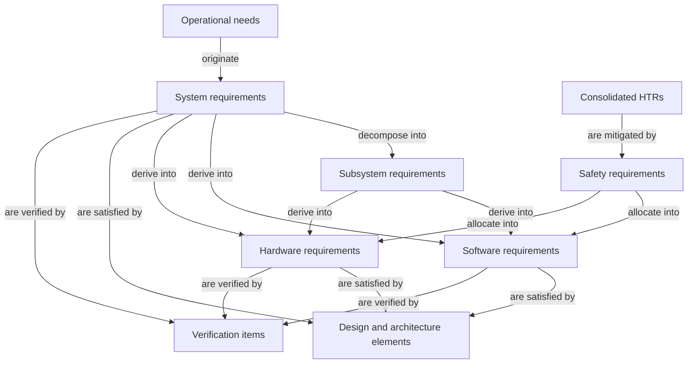

# Traceability profiles and matrix artifact

Original implementation proposal, November 14, 2026. The profile manager and matrix artifact have since been implemented in the local working tree. See the [implementation and validation report](../investigations/traceability-profiles-and-matrix-2026-11-14.md) for delivered capabilities, test evidence and remaining limits. The proposal below preserves the broader design intent.

## Product model

Create a versioned **Traceability Profile** as the shared definition of permissible relationships and required coverage. Provide a Rules table and Scheme diagram as synchronized views of the same profile. Create a **Traceability Matrix** artifact that evaluates actual object relationships against a selected profile and selected source revisions. The profile defines the expected structure; the matrix presents the evidence, coverage and exceptions.

IBM DOORS documents link modules, linksets and pairings for controlling source/target modules. Jama documents reusable relationship rule sets, coverage requirements, project assignment and a diagram of those rules. These support providing both an explicit rule editor and a visual scheme over one authoritative model:

- [IBM: Link modules, linksets and linkset pairings](https://www.ibm.com/docs/en/engineering-lifecycle-management-suite/doors/9.7.0?topic=requirements-link-modules-linksets-linkset-pairings).
- [Jama: Set up relationship rules](https://help2.jamasoftware.com/ah/en/administration/organization-administrator/managing-process/managing-relationships/set-up-relationship-rules.html).
- [Jama: Understanding the diagram and suspect links](https://help.jamasoftware.com/ah/en/manage-content/coverage-and-traceability/live-trace-explorer/understanding-the-diagram.html).

The xHandle defaults below are product recommendations, not a claim of compliance with an engineering standard.

## Existing implementation and integration points

- `artifacts/engineeringProjectModel.js::engineeringProjectTrace` constructs a graph from selected document revisions, object source evidence, architecture snapshots and project dependencies. It detects historical references and unresolved evidence. `uses-drafting-input` records generation order and source availability.
- `artifacts/artifactRequirementsAdapter.js::artifactRequirementRows` projects source evidence as `refines` links for existing trace views. These links establish provenance. They cannot automatically establish satisfaction, mitigation, allocation or verification.
- SysML exposes `derivedFrom`, `satisfies`, `verifies`, `mitigates`, `allocatedTo` and other trace types in `SysMLV2Modeler/sysmlV2Types.js`. Legacy requirement modules also retain typed links. A shared adapter must preserve their direction and semantics.
- Artifact revisioning, source freshness, project acceptance, baselines, exports, table filters, search and Collaborator already provide reusable UI and persistence patterns.

Use namespaced references to canonical objects. Keep source evidence in its owning repository and resolve it through adapters; avoid a second editable copy of requirement text or a separate link store for each matrix. The first release should support Design Management objects and its existing Projects/Code-Based Architecture evidence. Additional System Test or other adapters must explicitly report capabilities and unavailable sources.

## Profile definition and selection

Ship **xHandle Systems Engineering v1** as a built-in profile. Users can duplicate it or create a custom profile, name it and publish a version. Published versions are immutable. Rules can have stable IDs, descriptions and a rationale so users can understand why a link is expected.

A systems engineering project selects a profile version and binds its roles to actual artifacts, modules or diagrams. One role can include several documents. Standalone matrix creation also selects a profile and bindings. A matrix normally inherits its project's selection. An explicit matrix override is labeled as an alternate assessment and does not silently change the project’s active rules.

Document types supply initial role suggestions. Object kind and explicit role mapping decide applicability: a section heading, narrative paragraph and requirement in the same document are different entities. Custom/legacy modules can be mapped to roles without renaming or rewriting them. Folder membership does not imply a relationship or change project ownership.

When a profile changes, show an impact preview against existing links, then require explicit application of the new version. Preserve old profile versions and historical matrix results. Existing links that violate a newly selected profile remain visible as findings; never delete or reinterpret them automatically.

## Rule definition

Each rule has:

| Field | Meaning |
| --- | --- |
| Source and target selectors | Semantic roles, artifact types/instances, object kinds and supported attribute conditions. |
| Relationship | Stable type, forward label, inverse label and permitted direction. |
| Allowed or prohibited | Whether the relationship can be created for matching endpoints. |
| Coverage obligation | Whether applicable source objects, target objects or both require coverage. Being allowed does not make a relationship mandatory. |
| Cardinality | Minimum/maximum qualifying links per applicable endpoint. Many-to-many is supported. |
| Alternatives | An explicit group such as “system requirement OR subsystem requirement”; separate required groups remain AND obligations. |
| Applicability and stage | Allocation, scope and milestone conditions; a missing source never automatically disables a rule. |
| Qualification | Whether links must be reviewed/current, which endpoint revisions are eligible, and whether direct links or a defined multi-hop path count. |
| Enforcement | Finding severity and whether unmet obligations block a configured acceptance/baseline gate. |

Use declarative selectors rather than executable user scripts. Validate profiles before publication: contradictory allow/prohibit rules, unknown roles/types, impossible cardinalities and unintended derivation cycles need clear errors. Default required relationships use direct links. Multi-hop coverage must name the permitted path; it must not make one upstream citation count as every downstream assurance claim.

Store one directed relationship and render its inverse label as needed. For example, `safety requirement --mitigates--> HTR` reads inversely as `HTR --is mitigated by--> safety requirement`. Coverage on HTRs counts incoming mitigation links. Do not store two independent inverse links.

## Recommended default scheme

These defaults apply to substantive objects in bound roles, with recorded exclusions and stage applicability. They do not require every document type to exist in every project.

| Source object | Relationship | Target object | Default coverage expectation |
| --- | --- | --- | --- |
| System requirement | Derived from | Operational need in Concept of Operations, or an explicitly justified source decision | At least one supported origin per requirement. |
| Subsystem requirement | Derived from | System requirement | At least one parent per subsystem requirement. |
| Software or hardware requirement | Derived from | Applicable system, subsystem or allocated safety requirement | At least one valid parent across these alternatives. Explicitly allocated parent requirements must also have downstream coverage. |
| Safety requirement | Mitigates | Consolidated HTR/actionable safety issue | At least one HTR per safety requirement; at least one mitigating requirement per applicable HTR, or an explicit reviewed disposition. |
| Interface requirement | Derived from | Applicable system or subsystem requirement | At least one parent and identifiable interface endpoints. |
| Design/architecture element | Satisfies | Allocated requirement | Required design coverage at the configured design milestone; engineering review confirms the claim. |
| Verification case or other supported verification item | Verifies | Requirement | Required verification-method coverage at the configured verification milestone. Execution evidence and outcomes are assessed separately. |

Safety requirements may also be derived from higher-level requirements and allocated to software/hardware. Decomposition and allocation are explicit; do not force an artificial subsystem layer or force every requirement into both software and hardware. A built-in profile uses OR alternatives where several legitimate paths exist.

HTR coverage uses consolidated issues. Original assessment rows remain accessible through HTR provenance, without becoming thousands of independent matrix obligations. An HTR with no recorded constraint can still have an unresolved mitigation obligation. An architecture snapshot or code reference alone does not prove satisfaction or successful verification. A test link establishes a verification relationship, not a passing test.

The diagram presents upstream-to-downstream flow using inverse labels where appropriate:

The diagram illustrates selected routes. The Rules table supplies precise alternatives, applicability and cardinality, including interface and safety obligations.

## Matrix artifact and coverage

Add **Traceability Matrix** to artifact creation. Its configuration includes the profile/version, owning project, role bindings, source revisions/baseline, included rules and assessment stage. A scoped subset of rules is clearly labeled as a partial assessment. Selecting unavailable verification tooling produces a visible unavailable-source finding; it does not yield a successful assessment.

Provide two useful presentations over the same evaluation:

- **Coverage table:** One row per applicable object and rule obligation. Show ID, title/text, source artifact, expected relationship, linked targets, status and finding. Include rows with zero links. Support configurable/resizable columns and searchable multiselect filters on every column. Drill into the original object, HTR assessments or link rationale.
- **Pairwise matrix:** Select two bound roles; show objects on axes and typed relationships in cells. Selecting a cell opens link details or creates a rule-permitted link. A broader multi-stage trace view can follow the same relationships.

Evaluate scope independently of UI filters. Filtering the table cannot improve coverage scores or hide missing obligations from an exported assessment. Show totals per rule and counts of reviewed/current, missing, suspect, invalid, excluded and unassessed obligations. A zero-object or unavailable population displays “Not assessed,” not 100%.

Distinguish relationship state from assessment findings. Relationships can be proposed, confirmed, suspect or retired. Findings identify missing required links, disallowed types/directions, cardinality violations, dangling targets, out-of-scope endpoints or unavailable evidence. Explicit exclusions record rationale, author/review status and affected rule/object; report them separately from satisfied coverage. Draft and unreviewed links remain visible but do not count as confirmed/current coverage by default.

Endpoint references include stable object identity, owning artifact, revision and content identity. Detect semantic changes to linked objects and flag affected relationships as suspect. Historical baseline assessments remain reproducible against their pinned revisions. A confirmed relation is not automatically reconfirmed after a source change, profile switch or revised consolidation.

Generate the matrix deterministically from stored links and rules. AI may propose candidate relationships and rationale through the existing reviewable Collaborator workflow. It cannot manufacture accepted links, change profile rules, or mark verification successful merely to complete coverage. Preserve provenance separately and never bulk-convert old `refines` citations into stronger engineering claims.

Live exploration can follow current working content with a conspicuous draft label. A saved/accepted matrix revision pins the profile version, source manifest and relationship revisions; refreshing creates a new assessment with a change summary. Exports include those identities, statuses, exclusions and summary counts.

## Implementation sequence and acceptance checks

1. Build the versioned profile/rule model, default profile, project/standalone selection, role binding, import/export and Rules table. Add a scheme diagram from the same data; diagram editing must use the same validation and persistence path.
2. Add the canonical typed-link service and adapters. Apply the active profile in manual link editors and Collaborator proposals. Always reject malformed/dangling new links; apply profile enforcement consistently. Missing coverage may remain during drafting and is evaluated at configured gates. Preserve older links as explicit provenance or review findings.
3. Add the deterministic evaluation engine and Traceability Matrix artifact, including coverage rows for unlinked objects, pairwise presentation, filters, export, profile/revision pins and baseline/review behavior.
4. Add change-impact review, bulk reviewed proposals and remaining supported-area adapters. Reuse the engine in existing trace views so they do not develop independent coverage semantics.

Use indexed endpoint/rule lookups and sparse relationships rather than materializing every possible object pair. Build assessments off the interaction path with bounded work, progress, cancellation and pagination/virtualization. Load original hazard assessments or code snapshots only on demand. Changes should invalidate affected rules/objects rather than rebuild every matrix on each interaction.

Verify default/custom profiles, forward/inverse direction, OR/AND obligations, per-endpoint cardinality, object-kind applicability, stage conditions, cross-project scope, evidence versus engineering relationships, suspect transitions, excluded/unavailable populations, historical revisions, import validation and concurrent edits. Confirm that custom profile selection survives reload and backup/restore and that modifying a profile does not rewrite saved matrices or source documents.

Run live browser and isolated Electron scenarios with representative large code projects and consolidated HTLs. Verify matrix creation, rule editing in both presentations, allowed/blocked links, missing rows, filtered and unfiltered counts, jump-to-object navigation, source changes, proposal review, exports and responsive input during evaluation. Actual implementation and test results are recorded in the linked implementation report.
