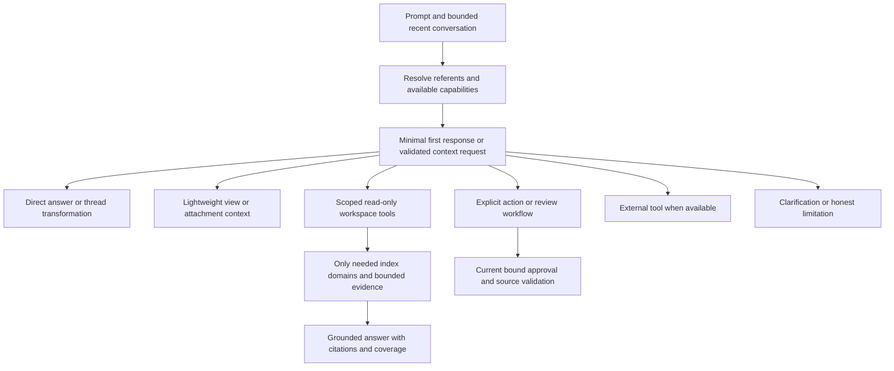

# Collaborator intent and context routing review

Executed [the review prompt](../prompts/collaborator-intent-routing-review-2026-11-04.md) against the pending working implementation. This is a review, not a fix. Application code, credentials, provider preferences and the user's running preview were not changed during this review. No paid provider calls or customer workspace tests were performed.

The screenshot is consistent with a confirmed application routing defect. A weather question falls through to workspace preparation before any model is called. Optimizing that preparation and adding greeting exceptions did not change this fundamental fallback.

## Ranked findings

### P1 — Unrecognized prompts default to workspace retrieval, including unrelated questions

`XHandleCopilotView.jsx:7543–7563` permits the direct route only when `isCasualConversation` or `isGeneralKnowledgeQuestion` matches. Everything else invokes `buildWorkspaceLLMContext`. The general-question helper is a complete-phrase whitelist of a few engineering subjects (`conversationRouting.js:13`). Therefore weather, ordinary general knowledge, most paraphrases, screen-orientation questions and conversational transformations enter storage work.

`workspaceGraphContextBuilder.ts:355–363` then chooses an optional narrow index scope, awaits migration and queries the graph. `workspaceIndexScope.js` narrows only supported deterministic data lookups; for unrelated questions it returns null, which selects the broad pass. The later `shouldReadWorkspace` check (`workspaceReadSession.js:7`) cannot prevent work that has already happened. It only decides whether an additional targeted-read stage is needed.

Reproduced through the optimized App in Electron and Chrome. With the workspace mutation lock held, “Whats the weather today?”, “Explain recursion in simple terms.” and “Translate your previous answer into Spanish.” waited before issuing an answer request. After lock release, their requests contained an unrelated synthetic requirement marker. A greeting and the exact supported software-requirement definition answered without waiting or receiving that marker. This is unnecessary data inclusion in the selected model's request, not evidence of an external data breach.

**Required change:** determine evidence requirements before any graph or index dependency. Direct conversation must be possible for arbitrary ordinary questions, not just whitelisted formulations. Uncertainty must not imply “load the entire workspace.”

### P1 — A conversational “yes” can authorize an older pending edit

At `XHandleCopilotView.jsx:6559–6563`, the app finds an unfinished workspace plan anywhere in the current thread. At `6663–6670`, a bare `yes`, `confirm`, `go ahead` or similar response applies it without requiring that the latest assistant question is requesting approval of that plan. `applyWorkspacePlan` (`6414–6417`) delegates to the authoritative write provider; source validity checks do not establish what the user is agreeing to now.

A disposable Electron test reproduced a synthetic requirement changing after the latest assistant question was “Should I keep my next response concise?” and the user answered “yes.” The plan belonged to an earlier requirement-edit proposal. The final UI-driven probe created that proposal through the actual App with a valid mocked planner response, verified that it initially remained unapplied, asked the unrelated question through normal chat, and then sent “yes.” The old edit was applied; no new non-title model request was issued for that confirmation. No real user record was used.

**Required change:** bind confirmation to a particular pending plan, thread, proposal revision and current confirmation turn. A topic change must suspend implicit approval. An explicit Apply control on the exact card can remain available. Source freshness, rollback and scope checks must remain in place. Do not remove existing Collaborator review prompts or their decision flows.

### P2 — Rewriting conversation text is classified as editing saved workspace data

`workspaceActionPlan.js:1–2,31–38` treats `make`, `remove` and similar verbs together with `it`, `that` or `this` as workspace-mutation intent. Consequently “Make it shorter.” and “Remove that last sentence.” match the workspace-action classifier. This branch runs before the conversation shortcuts (`XHandleCopilotView.jsx:7521`) and calls `prepareWorkspaceActionPlan`, which fetches project context and hydrates candidate bodies (`6455–6476`).

The production-App probe reproduced “Make it shorter.” waiting for storage and issuing a workspace-planner request. With a valid synthetic clarification response it returns a workspace-planning clarification, not a rewrite. Earlier probe runs supplied ordinary non-JSON text to that planner and exercised its repair request; the extra retry in those runs is a fixture effect, not a claim that real models always retry.

**Required change:** resolve the object of an edit from the current conversational turn and explicit source references. Text transformation and saved-record mutation are distinct capabilities. Ambiguous “change that” should clarify rather than preselect a write workflow or broad retrieval.

### P2 — Current-screen orientation has no lightweight route

“What are we looking at?” should usually use the current view's bounded metadata. It is not itself a request to analyze every saved artifact. The same broad retrieval gate currently handles it. Reproduced with the architecture dashboard visible, matching the screenshot, and with a project view. It also occurs in full-page Collaborator.

The app already supplies focus metadata at `App.js:6956–7034`, including section, visible project, tab and selected items. However, it does not explicitly describe dashboard versus project detail, the rendered title, or the visible filtered project list/count. Its `activeTab` also comes from the general project-tab state, while CBA has a separate tab field. A future direct route must not simply assume any active tab/project ID describes the current screen.

**Required change:** define a small typed view snapshot from existing UI state: view kind/title, visible project/repository when applicable, filtered result counts, tab, and bounded selection descriptors. Distinguish a description of what is visible from analysis of its complete underlying dataset. Full-page mode must truthfully identify the Collaborator page and only use prior-view metadata when explicitly applicable.

### P2 — Context collection is still eager outside the routing decision

Both docked and full-page callers compute `getActiveProjectContext()` as a prop (`App.js:16381` and `17322`). That function reads/parses the project map, requirements and SysML caches, scans localStorage keys, and copies legacy CBA rows (`6721–6779`) before the child can choose a direct route. Calling the fallback “safe, synchronous” does not make its cost bounded by intent.

This is a separate source of unnecessary work even for messages that bypass the graph. Its contribution to the customer's minutes-long delay was not measured; the lock probe establishes the graph wait independently. The prior small synthetic workloads did not establish the cost of large legacy localStorage values during repeated App renders.

**Required change:** keep ordinary React props lightweight and memoized. Pass explicit lazy data providers rather than prebuilt workspace bodies. The rest of the application may legitimately read its own storage; tests should assert no additional Collaborator preparation on direct turns, not prohibit all application storage access.

### P2 — Routing and targeted read planning do not share a general conversation-referent resolver

The two direct classifiers see only the current string and three Boolean flags. `prepareWorkspaceReadEvidence` and `workspaceReadPlannerMessages` receive the current query, scope and candidate metadata, not a resolved conversational reference (`workspaceReadSession.js:5–22`, `workspaceReadPlanner.js:36–46`). The final answer receives compact history only after context preparation (`XHandleCopilotView.jsx:7655–7658`). Specialized review/action paths do inspect history, so it would be inaccurate to say history is ignored everywhere.

There is no common decision that “the second one” refers to the previous answer rather than the selected table, a named saved report, or an older pending action. Native conversation transformations show one consequence; incorrect factual answers to ambiguous saved-record follow-ups have not been demonstrated by this review's mocked responses.

Attachments have the same structural problem: `hasAttachments` disables both direct shortcuts, although an attachment-only summary need not read any saved workspace data (`conversationRouting.js:4,14`; `XHandleCopilotView.jsx:7544`). Specialized diagram extraction remains useful, but should not automatically imply graph retrieval.

**Required change:** share explicit thread referents, selection references and pending-operation state with the context decision. Context needs must compose: conversation plus attachment, selection plus a targeted record, or multiple explicitly requested projects. Low confidence should lead to a short clarification or a bounded reference-resolution step.

### P2 — Existing tests cover the shortcuts, not the intended routing contract

`conversationRouting.test.js` covers recognized greetings and four engineering formulations. It even treats “What is a project?” as a negative definition case; combined with the caller's fallback, that means unnecessary workspace preparation. These tests can all pass while the user-facing requirement fails.

The existing acceptance journey checks a greeting, one exact definition, a report list and a count. It did not cover weather, general knowledge outside the engineering whitelist, thread-only transformations, lightweight screen orientation or stale conversational approval. The existing 128 relevant regressions pass alongside the defects reproduced here. Passing them does not establish correct intent routing.

**Required change:** write acceptance expectations in terms of permitted data dependencies and behavior, including paraphrases and counterexamples. Keep regression checks for accurate saved-data reads and confirmed actions, so fixing over-retrieval does not produce under-retrieval or revive deprecated review UI.

## External-information limitation

The normal Collaborator answer path builds a messages/streaming payload (`buildCollaboratorChatPayload`, `XHandleCopilotView.jsx:1384–1406`) and calls the selected model (`7764–7770`). It does not attach a live weather/search tool or execute a general external lookup loop. The server has support for some tool payload fields and separate voice/transcription workflows; that is not evidence that ordinary Collaborator weather questions can fetch current conditions.

For the screenshot prompt, an appropriate fast response must either use an explicitly available external capability with an appropriate location, or honestly state the current limitation. It must not fabricate today's weather, assume a location from a project, or say it will look up live information when no such tool is available. Adding external integrations is a separate product decision, not necessary to fix the routing defect.

## Proposed design

Use a context-on-demand conversation orchestrator. Do not implement another large whitelist, a blanket “skip data unless these nouns appear” rule, or a compulsory second model call before every response.

1. **Build a cheap turn envelope.** Capture the thread ID, bounded recent messages/referents, the current view descriptor, attachment descriptors, available capabilities and explicit user constraints. Do not hydrate project/table/history/source bodies here. Do not treat an open project as consent or necessity to read its complete dataset.
2. **Preserve reliable deterministic routes.** Explicit tool clicks, exact selected-record commands, straightforward counts/lookups and bound review decisions can retain fast, tested local handling. Conversation rewriting must resolve the textual object before reaching a workspace-edit planner. A pending plan must not capture every later affirmation.
3. **Let the first ordinary model turn answer or request evidence.** Give it a small trusted capability description and bounded conversational context. Use validated native tool requests where supported. For adapters without equivalent tool support, use a bounded structured answer/read-request protocol. This first turn is not a mandatory separate classifier followed by an unconditional answer call. Do not stream internal tool/plan JSON into the answer UI.
4. **Keep execution policy outside the model.** Validate requested capabilities, project/repository/run/history scope, source IDs, argument sizes and read budgets. Start only the required index domain(s) after a workspace read is requested. Preserve provenance and incomplete/stale coverage. Model requests cannot directly authorize writes; retrieved source text cannot become instructions or approvals.
5. **Handle ambiguity explicitly.** Clarify unresolved referents or targets without first sweeping the whole graph. A bounded lookup is appropriate when it can resolve a specific reference; “unknown” is not a reason to request everything. Stop or reject unsupported tool requests without silently switching to a broad fallback.
6. **Compose evidence needs.** “Summarize this attachment” is attachment-only. “Compare this attachment with SWR-1” needs both. “What does WeatherEstimator do in this project?” needs saved data despite the word “weather.” “Explain hazard analysis, then count ours” needs general explanation plus a scoped read, not one mutually exclusive keyword category.
7. **Report real work.** Show retrieval only after selecting a workspace tool, with its target/domain where useful. Keep local preparation, provider wait, tool execution and generation distinguishable. Record bounded numeric route/dependency timings separately from fatal-error logs; do not add routine routing messages to the user's crash/error history.

### Routing alternatives

| Approach | Benefit | Material problem |
| --- | --- | --- |
| More phrase exceptions | Small patch | Repeats the defect for new wording, languages, attachments and follow-ups |
| A mandatory model classifier before every answer | Semantic flexibility | Adds a serial provider wait, cost and a new failure point to all turns |
| Keyword-only workspace detection | Cheap | Misses implicit saved-data references and misreads domain words in general questions |
| Minimal first turn with on-demand tools, plus reliable local routes | Semantic flexibility with conditional retrieval | Needs adapter validation, bounded loops, reference handling and strong behavior tests |

The final option is the recommended architecture. It requires representative model evaluations after the deterministic dependency gates pass. This review did not measure live model routing accuracy or provider latency.

## Required behavior and permission matrix

| User request / condition | Evidence needed | Must not happen |
| --- | --- | --- |
| Greeting, ordinary general question, paraphrase, topic change | Bounded conversation/general knowledge | Graph/index/read-planner calls or fresh workspace bodies |
| “Whats the weather today?” / “Should I bring an umbrella?” | Available external capability, or honest limitation | Workspace lookup, fabricated current conditions, assumed location |
| “What are we looking at?” | Accurate bounded current-view metadata | Complete project/table/history scan |
| “Make it shorter” / translate / remove last sentence | Current conversational referent | Workspace edit proposal or stored-record mutation |
| Summary of an attached file/image | That attachment, bounded extraction | Unrelated workspace retrieval |
| Compare attached spec with SWR-1 | Attachment plus authorized exact saved record | Whole-workspace sweep or scope expansion |
| Count software requirements / review selected hazard | Authorized typed records or selection, needed data tools | False totals from samples; skipped needed grounding |
| “What does WeatherEstimator do in this project?” | Saved source/architecture evidence | Treating a named function as a live weather request |
| “What about the second one?” | Current thread referent, or clarification | Guessing a project/table/action from stale focus |
| Unrelated “yes” while an old plan is pending | Current conversational question | Applying/cancelling that old plan implicitly |
| Apply a specific current plan | Bound explicit approval plus source checks | Model-only write authorization, stale or cross-thread approval |
| Project/history comparison | Explicitly resolved projects/runs and coverage | Mixing current/history, wrong-project samples or invented links |
| Instructions embedded in an attachment/report | Treat as untrusted content | Route/permission/confirmation override |

## Implementation sequence and acceptance gates

1. Add a fixed context-dependency matrix and hold-lock/failed-storage tests first. They must fail on this implementation for the reproduced inappropriate routes. Include named records, mixed intents, paraphrases, other languages, pending decisions and scope collisions.
2. Introduce the minimal turn/view/reference structures and lazy context providers. Remove heavy parent-context construction from unrelated Collaborator turns without changing the rest of the UI's legitimate data access.
3. Implement conversation/view/attachment handling and on-demand read tools through the shared orchestrator, retaining existing read-policy, citation and coverage validation. Keep native provider features behind an adapter, with a validated fallback; preserve selected provider/model/effort.
4. Bind pending plan/review approval to its current turn and revision. Test the exact unrelated-yes case, cancellation, source changes and thread switching before enabling the new route generally.
5. Exercise the actual optimized App in docked and full-page modes in Chrome and Electron. Use a sentinel record never included in conversation history: unrelated messages must complete with the storage lock held and must not include that sentinel in outgoing requests. Targeted reads must still block or report unavailability appropriately, never invent an exact answer.
6. Test lazy attachment/view reads, meaningful source retrieval, current/history separation, prompt injection and bounded memory. A direct turn should not start a large legacy parse or a bulk index. Trace calls per turn so independent background work is not mistaken for foreground retrieval.
7. Only then run a budgeted representative evaluation with actual selected models. Score routing, factual answers, grounding, citations, scope, first useful text and total time separately. A mocked provider can prove dependency behavior, not answer quality. Do not claim “once and for all” from unit-test counts or one successful model.

No universal millisecond guarantee is appropriate. The primary deterministic gate is independence from unrelated blocked/failed storage; warm/cold latency and memory should then be measured on representative workloads.

## Validation and evidence

- 128 existing relevant tests passed across six suites: direct classifiers, read session, focused indexing policy, action planning/execution and Collaborator component helpers. These are regression checks, not proof that the reported defects are fixed.
- A 28-case probe of the current pure classifiers recorded two direct shortcuts, three workspace-mutation candidates and 23 workspace-default candidates. This is an illustrative behavior matrix, not a balanced model-accuracy benchmark; some workspace-default cases are correct and specialized earlier routes exist.
- Production-App probes used disposable profiles, the actual optimized bundle, a controlled mutation Web Lock and local mocked provider responses. They covered project-docked Electron/Chrome, the CBA-dashboard dock and full-page Chrome. Provider preferences included synthetic Claude Haiku 5.5/medium, OpenAI/high and Gemini/medium. No customer keys were used.
- Every prompt in a held-lock case was sampled after approximately 1.1 seconds and then the lock was released intentionally. These wall times are controlled dependency experiments, not real-provider performance measurements.
- The unrelated marker was placed only in a synthetic saved requirement, not in the mocked answer/history. Its presence in a later request demonstrates unnecessary fresh data inclusion. A screen-orientation request on the dashboard did not always include that particular marker; it still waited on graph preparation. Do not overstate marker results as universal data inclusion for every case.
- Initial action-planner probes used a non-JSON mock response and therefore hit the existing repair branch. Final routing probes use valid clarification JSON to demonstrate the wrong route independently of that fixture behavior.
- One initial confirmation probe ran before graph initialization and failed with “Graph schema unavailable.” That fixture was corrected by preparing data through a normal App question. It is not listed as a product defect.

Local evidence files are summarized in [the evidence JSON](collaborator-intent-routing-review-2026-11-04.json). The review prompt, report and evidence JSON are the only intended repository additions. Temporary diagnostic drivers and logs live under `/private/tmp`. SHA-256 comparison of all 867 application source files before/after the review found no changed, added or removed application files. Four initial whole-App runs cover 32 prompt observations; the final dashboard/full-page runs use the corrected planner mock. The separate UI-driven confirmation probe demonstrates the write defect.

## Model recommendation

Use **GPT-6 Astra with High reasoning** for this architectural review and its bounded follow-up implementation. This is a recommendation, not a statement that this conversation switched models or launched a separate Astra agent. [OpenAI describes Astra for demanding reasoning/coding work](https://developers.openai.com/api/docs/models/gpt-6-astra), and its [reasoning guidance](https://developers.openai.com/api/docs/guides/reasoning) recommends High for complex debugging while reserving Extra High for demonstrated benefits that justify additional latency/cost.

Model choice will not fix the fallback semantics by itself. The durable result depends on the context-on-demand design and the behavior gates above. No application change, commit, push or desktop release was made as part of this review.
